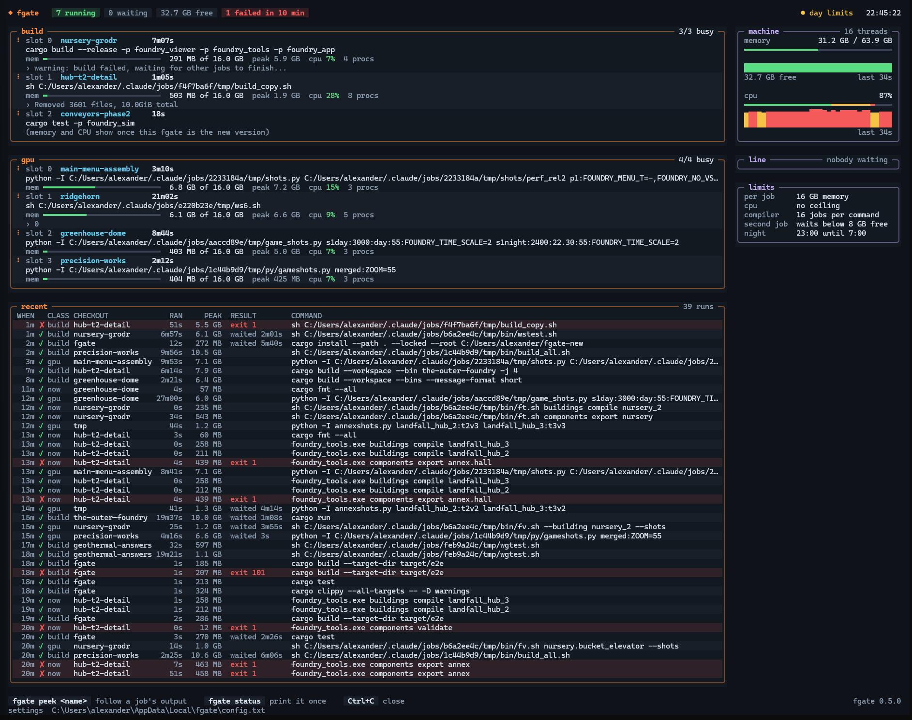

# fgate

**The fair gate: a build gate for coding agents that share one machine.**

Run five or ten coding agents (Claude Code, or anything else with a shell) on one machine and sooner or later
they all start `cargo build` at once. Memory fills up, the machine freezes, and builds die with "out of memory".
fgate makes them take turns. Each heavy command waits in a fair line for a free slot, then runs unchanged at low
priority, within a memory and CPU ceiling. `fgate watch` shows the whole thing live. It runs on Windows, Linux and
macOS.



```text
fgate cargo test -p my_crate        waits for a build slot, then runs the command unchanged
fgate --gpu my_game.exe --shots     waits for the GPU slot (games, renderers, screenshot scripts)
fgate --now cargo publish           skips the line: small commands, within a small memory ceiling
fgate status                        who holds the slots, who is waiting
fgate watch                         the same, live: memory, CPU, each job's usage, recent runs
fgate hook [options]                an agent hook (Claude Code, Copilot) that refuses cargo and C++ builds without fgate
```

## Install

fgate runs on Windows 10/11, Linux and macOS, and needs Rust 1.87 or newer.

```sh
cargo install fgate --locked
```

That puts `fgate` in `~/.cargo/bin`. One install serves every project and every agent on the machine.

## Using it

Put `fgate` in front of any command that compiles or runs something heavy:

```sh
fgate cargo build --release
CARGO_TARGET_DIR=~/shared/target fgate cargo test --workspace
fgate --gpu python take_screenshots.py      # a script that runs the game is gated as a whole
```

A waiting command prints its place in line and who is running, and tells you again whenever that changes:

```text
fgate: waiting for a build slot: #2 in line; running: smelter-2: cargo build --release (1m40s)
fgate: build slot 0 after 2m05s in line — cargo test --workspace
...
fgate: done in 1m12s, peak memory 6.9 GB
```

### Small commands: `--now`

Waiting ten minutes behind three builds to run `cargo fmt`, a publish or a quick tool is silly. `fgate --now`
runs a small command at once, without waiting in line, but it can't be used to slip a build past the queue:

- It runs within a small memory ceiling, `now_mem_gb` (2 GB). A command that grows past it fails with "out of
  memory", and fgate says it is too big to skip the line and should run again without `--now`.
- It still waits while free memory is below `min_free_gb` and something else is running, like any second command.
- At most `now_slots` (4) run at once. `status` and `watch` list them under `now` while they run.

The command's own output and exit code pass through untouched. A gated command that itself runs `fgate …`
(a script calling cargo, say) doesn't queue a second time: it already holds the slot.

Agents name their place by their folder, or by their worktree for checkouts under `.claude/worktrees/<name>`,
so the status shows `spaceport-sp1: cargo build` rather than a process id.

## Checkouts sharing one target directory

Agents often work in git worktrees, one checkout each, and build into one shared `CARGO_TARGET_DIR` so the
dependencies are compiled once. That is safe for the dependencies, but not for the workspace's own crates: cargo
names their build output by their path relative to the workspace, so every checkout writes to the same files, and it
judges freshness by file times. When another checkout built more recently, your sources look older than its build
and cargo reuses it: your program runs another checkout's code, or fails to compile against its API.

So before a compiling cargo command (`build`, `check`, `test`, `run`, `clippy`, `doc`, `bench`, `rustc`) into a
target directory set by `CARGO_TARGET_DIR` or `--target-dir`, fgate looks at `.fgate-checkouts` in that directory:
who built this profile last (`debug`, `release`, a custom profile, per target triple). When it was another checkout,
or nobody is recorded yet, fgate first cleans this workspace's own packages for that profile (`cargo clean -p
<member> …`; the dependencies stay) and records this checkout:

```text
fgate: release in E:\code\game\target was last built by another checkout (E:\code\game\.claude\worktrees\a): cleaning
this workspace's 8 package(s) there first, so cargo doesn't reuse them (switch_clean)
```

That costs a rebuild of the workspace's crates whenever checkouts take turns, never a rebuild of the dependencies.
A build into the workspace's own `target/` is left alone. `switch_clean = 0` turns it off.

That clean also deletes the executables a checkout has just built, as soon as another checkout's build gets the
slot, often before the first agent has run or copied them. So after a build succeeds, while it still holds the slot,
fgate copies the workspace's executables (its bin targets) into the checkout itself, where no other checkout's build
touches them:

```text
fgate: kept game.exe, game_tools.exe (unchanged) in E:\code\game\.claude\worktrees\a\target\fgate-bin\debug: run it
from there, the shared target's copy goes with the next checkout's build (keep_bins)
```

It copies only when the record says this checkout built that profile last, so a kept executable is always the
checkout's own code, and only what changed since the last copy. A kept executable that is running is renamed out of
the way, which Windows allows, rather than overwritten. `keep_bins = 0` turns it off.

## How it works

- **Kinds of slot.** Build slots for `cargo` and test runs, a GPU slot for games, renderers and screenshot
  scripts, so a screenshot run doesn't wait behind a build, and `now` slots for small commands that skip the line.
- **A fair line.** Waiters are served in the order they arrived. Places in line and slots are file locks in
  fgate's folder, which the system drops when a process ends however it ends. A crashed or killed agent never
  leaves a slot taken.
- **Waiting for memory.** Memory is usually what runs out first, and a build's memory grows as it goes. A second
  command waits while less than `min_free_gb` is free. At night, every command waits for it, even alone.
- **One job per command.** Once in, the command and everything it starts run as one job: at low priority,
  within one memory ceiling and a CPU ceiling for the whole process tree, and ended together, so no compiler is
  left running on its own. If the job hits its memory ceiling, fgate says so, so an "out of memory" from the gate
  isn't mistaken for a bug in your code. How each system does it is under [Platforms](#platforms).
- **Compiler jobs.** A gated command gets `CARGO_BUILD_JOBS` and `CMAKE_BUILD_PARALLEL_LEVEL` from the settings,
  unless it sets its own. CMake's applies to `cmake --build`; `ninja` or `make` run directly take only their own
  `-j`, and Ninja uses every thread without it. (`conan build` passes its own `-j` from `tools.build:jobs`; set
  that in Conan's `global.conf` to match.)
- **Night limits.** Between `night_from` and `night_until` (local time) stricter limits apply, for agents that
  keep working while nobody watches.
- **History.** Finished commands are logged to `history.log` in fgate's folder (last 300). `fgate watch`
  shows them with run time, peak memory, time waited and exit code.

## Settings

The settings live in `config.txt` in fgate's folder, one file per machine, so every agent counts the same slots.
fgate writes the file with defaults on first use. Edit it any time: each command reads it when it starts, and a
waiting command reads it again when it changes. `fgate status` shows where the folder is:

| System  | fgate's folder                                                  |
| ------- | --------------------------------------------------------------- |
| Windows | `%LOCALAPPDATA%\fgate`                                          |
| Linux   | `$XDG_STATE_HOME/fgate`, or `~/.local/state/fgate`              |
| macOS   | `~/Library/Application Support/fgate`                           |

| Setting             | Default             | Meaning                                                                 |
| ------------------- | ------------------- | ----------------------------------------------------------------------- |
| `build_slots`       | 1                   | builds and test runs at once                                            |
| `gpu_slots`         | 1                   | GPU runs at once                                                        |
| `now_slots`         | 4                   | small `--now` commands at once                                          |
| `now_mem_gb`        | 2                   | each `--now` command's memory ceiling                                   |
| `jobs`              | 6                   | `CARGO_BUILD_JOBS` and `CMAKE_BUILD_PARALLEL_LEVEL` for a gated command |
| `cpu_percent`       | 40                  | each command's hard CPU ceiling, percent of all threads (0 = none)      |
| `mem_gb`            | 40% of RAM, min 8   | each command's memory ceiling, its whole process tree (0 = none)        |
| `min_free_gb`       | 6                   | a second command waits while less than this is free                     |
| `night_from`        | 23                  | night limits start at this hour (`night_from = night_until`: never)     |
| `night_until`       | 7                   | and end at this hour                                                    |
| `night_build_slots` | 1                   | build slots at night                                                    |
| `night_mem_gb`      | 10                  | memory ceiling at night                                                 |
| `night_min_free_gb` | 8                   | at night any command waits while less than this is free                 |
| `switch_clean`      | 1                   | clean a shared target's workspace crates when another checkout built them (0 = off) |
| `keep_bins`         | 1                   | copy a shared build's executables into the checkout's `target/fgate-bin/` (0 = off) |

Any setting can be overridden for one command with an environment variable such as `FGATE_MEM_GB=16`.
`FGATE_DIR` points fgate at another folder, for trying it out without touching the real line.

**A starting point.** On a 16-thread, 32 GB machine running about ten agents, memory ran out long before the CPU
did. What worked: `build_slots = 1`, `jobs = 16`, `cpu_percent = 0`, `mem_gb = 12`, `min_free_gb = 6`. Guard
memory first. If a build hits its memory ceiling, lower `jobs` before adding slots.

## The agent hook

Agents forget the prefix. `fgate hook` is a [PreToolUse hook](https://docs.claude.com/en/docs/claude-code/hooks)
for Claude Code and GitHub Copilot (see [Setting it up for every project](#setting-it-up-for-every-project)) that
refuses a heavy cargo command (`build`, `check`, `test`, `clippy`, `run`, `doc`, `install`, `nextest`, …) or C++
build (`cmake --build`, `ctest`, `ninja`, `make`, `msbuild`, `conan build`/`create`/`test`, `conan install --build`,
also behind `uv run`) started without `fgate`, and tells the agent the command to use instead. Configuring
(`cmake -S . -B build`) and `--version`/`clean` runs go through. The agent retries with the prefix. Quoted
text and heredocs don't count, so `git commit -m "cargo test passes"` goes through.

Add it to the project's `.claude/settings.json` (or to `~/.claude/settings.json` for every project;
[examples/settings.json](examples/settings.json) has a complete file):

```json
{
  "hooks": {
    "PreToolUse": [
      {
        "matcher": "Bash|PowerShell",
        "hooks": [{ "type": "command", "command": "fgate hook", "timeout": 10 }]
      }
    ]
  }
}
```

A project can add its own rules as options:

| Option                    | Refuses                                                                       |
| ------------------------- | ----------------------------------------------------------------------------- |
| `--gpu name,name`         | these programs (exe names) when started without `fgate --gpu`                 |
| `--protect-branch <name>` | `git push` to this branch, such as `main` (repeatable)                        |
| `--protect-label <name>`  | `gh` commands that name this label, such as an approval label (repeatable)    |
| `--no-admin-merge`        | `gh pr merge --admin`, which skips required checks                            |
| `--note <text>`           | nothing: this text is added to every refusal, to point at the project's rules |

```json
"command": "fgate hook --gpu my_game,my_viewer --protect-branch main --no-admin-merge --note \"See AGENTS.md.\""
```

`FGATE_OFF=1` turns the hook off.

## Telling the agents

Agents use fgate when their instructions say so. Copy the section in [examples/AGENTS.md](examples/AGENTS.md)
into your project's `AGENTS.md` or `CLAUDE.md`, and the hook settings in
[examples/settings.json](examples/settings.json) into `.claude/settings.json`. The instructions mean agents get it
right the first time, and the hook catches the ones that forget.

## Setting it up for every project

fgate counts slots per machine, so the natural place for the hook and the instructions is your user profile, not each
repository: every project on the machine is covered, and no project's files change. Each agent needs two things, the
hook and a few lines of instructions ([examples/user-instructions.md](examples/user-instructions.md) has a section
for cargo and C++ builds).

| Agent                                       | Hook                                                                    | Instructions                         |
| ------------------------------------------- | ----------------------------------------------------------------------- | ------------------------------------ |
| Claude Code (also VS Code's Claude target)  | `~/.claude/settings.json`, as [above](#the-agent-hook)                  | `~/.claude/CLAUDE.md`                |
| GitHub Copilot: VS Code, CLI and the app    | `~/.copilot/hooks/fgate.json`, from [examples/copilot-hooks.json](examples/copilot-hooks.json) | `~/.copilot/copilot-instructions.md` |

On Windows `~` is `%USERPROFILE%`. The Copilot surfaces share one runtime and one hook folder, so the one file covers
them all. It sends Copilot's own `preToolUse` format (`toolName`, `toolArgs`); fgate reads it and answers in it. The
user `~/.claude/settings.json` is not read by Copilot, so an agent of each kind needs its own hook file.

Copilot cloud agent runs in GitHub's sandbox, not on your machine, so it has no use for fgate.

Check the hook by handing it a tool call:

```sh
echo '{"tool_input":{"command":"cmake --build build"}}' | fgate hook                          # Claude Code
echo '{"toolName":"bash","toolArgs":"{\"command\":\"cmake --build build\"}"}' | fgate hook   # Copilot
```

Both print a `deny` with the reason; a command fgate lets through prints nothing.

## Updating fgate while agents use it

On Linux and macOS, `cargo install fgate --locked` replaces it in place; running commands keep the old version
until they end.

On Windows, `cargo install` can't overwrite a running `fgate.exe`, and with the hook in place one runs almost all
the time. Build the new one beside it (through the gate, while the old one keeps working), then swap them by
renaming, which Windows allows while a program runs. Delete the old one once nothing runs it:

```sh
fgate cargo install fgate --locked --root ~/fgate-new
mv ~/.cargo/bin/fgate.exe ~/.cargo/bin/fgate-old.exe
mv ~/fgate-new/bin/fgate.exe ~/.cargo/bin/fgate.exe
```

A `fgate watch` that is open keeps showing the old version: restart it.

## Platforms

| | Windows | Linux | macOS |
| --- | --- | --- | --- |
| Fair line, slots, `--now`, memory waiting, night limits, `watch`, hook | yes | yes | yes |
| Low priority | below normal | nice 10 | nice 10 |
| Everything a command started ends with it | Windows job | process group | process group |
| Hard memory and CPU ceiling | Windows job | systemd scope (cgroups), with a systemd user session | no |
| Memory and CPU use per command | job accounting | process group (`/proc`), scope peak | process group |

- **Linux.** The ceilings need a systemd user session (`systemd-run --user`), which desktop and most server
  installs have. Where there isn't one (containers, WSL without systemd), fgate runs commands without ceilings and
  says so; the line and the wait for free memory still keep the machine safe.
- **macOS** has no way to hold a process tree to a memory or CPU ceiling, so commands run without one, and the
  wait for free memory carries the load. `--now` can't stop a command that grows too big here. Tested in CI on
  GitHub's macOS machines; reports from daily use are welcome.
- Commands run in their own process group. When fgate runs in a terminal, the command gets the terminal, so Ctrl+C
  and typed input reach it as usual.

## License

[MIT](LICENSE)

Used in my projects at [Vanir Forge](https://vanirforge.com).
